# AI Learning Lab

一个本地优先的 AI 学习、知识管理与资源收藏工作台。

**当前状态：阶段 1–8 全部完成（2026-10-30）。** 笔记能新建/编辑/删除（中文标题直接当文件名）；资源收藏能增删改、按类型/分类/标签筛选、三种排序，并能挂到某篇笔记上。链接只接受 http/https，应用**从不抓取**你填的地址。`Ctrl+K` 能搜全部笔记与资源：分组、摘要、高亮、`↑↓`/`Enter`/`Esc` 键盘操作，**不建索引**（每次搜都读文件，所以永远不会有"索引过期"）。学习任务有 Todo / 进行中 / 已完成三档、截止日期（会算逾期）、可关联多篇笔记与多条资源；总览页的数字全部从文件现算。阶段 7 把 `content/` 打成带清单的 zip（每个文件 sha256），恢复前先预览、先留快照、失败自动回滚；局域网默认关闭，打开后用口令登录，所有页面与写入都要过同一道门。阶段 8 补上了 Playwright 端到端测试（系统 Chrome；Windows 桌面 + Pixel 7 模拟）、axe 可访问性扫描（WCAG 2 A/AA，九个界面 0 命中）、性能基线、备份恢复的完整 E2E，以及 `app/error.tsx` 错误边界。**交付门槛是 `npm run verify`（451 条断言）加 `npm run test:e2e`。**

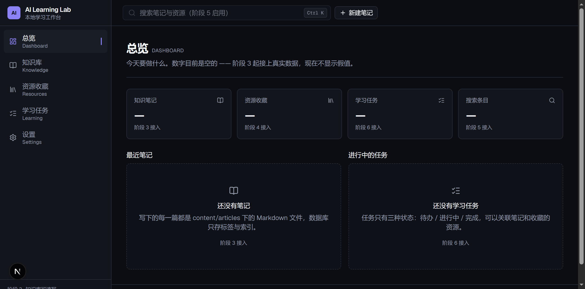

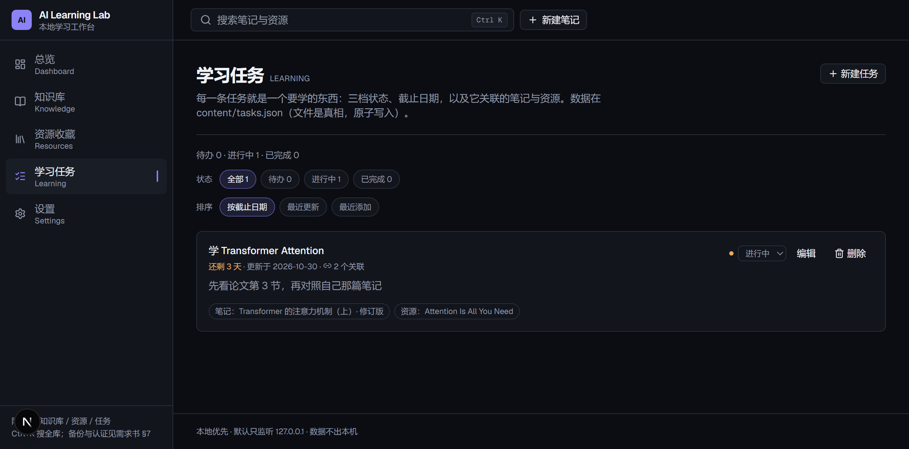

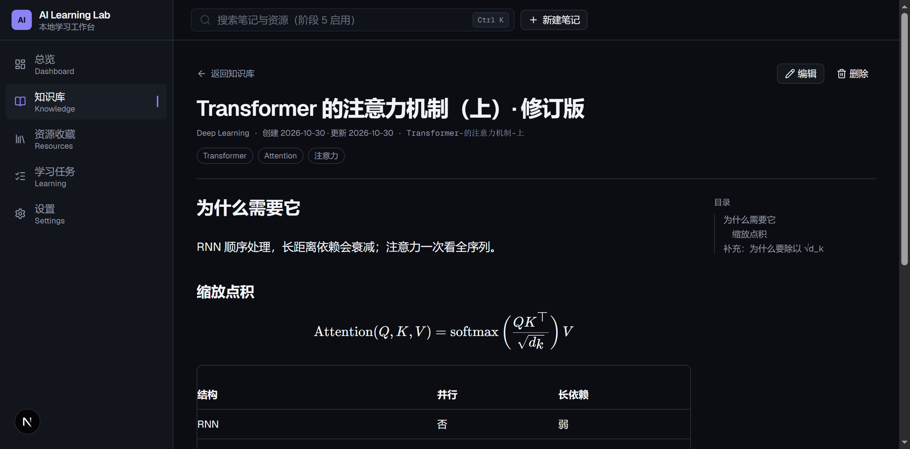

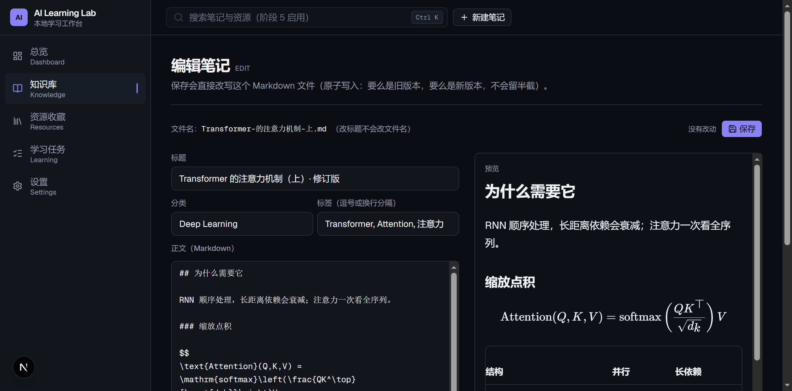

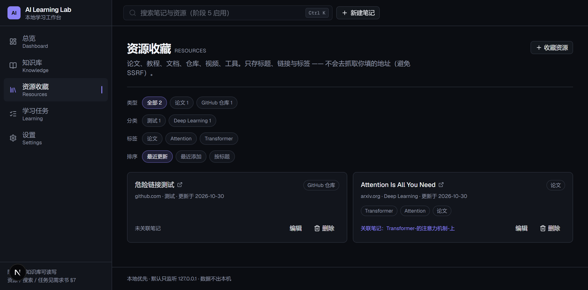

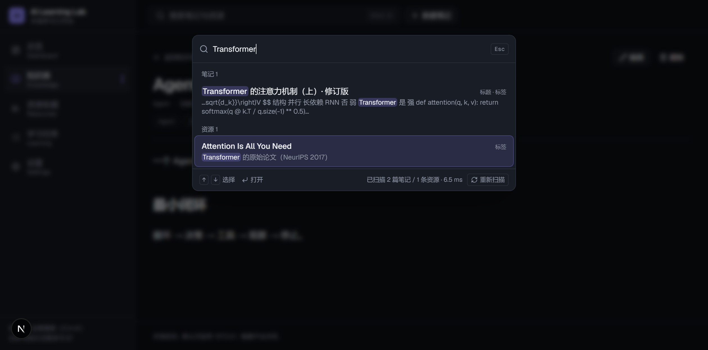

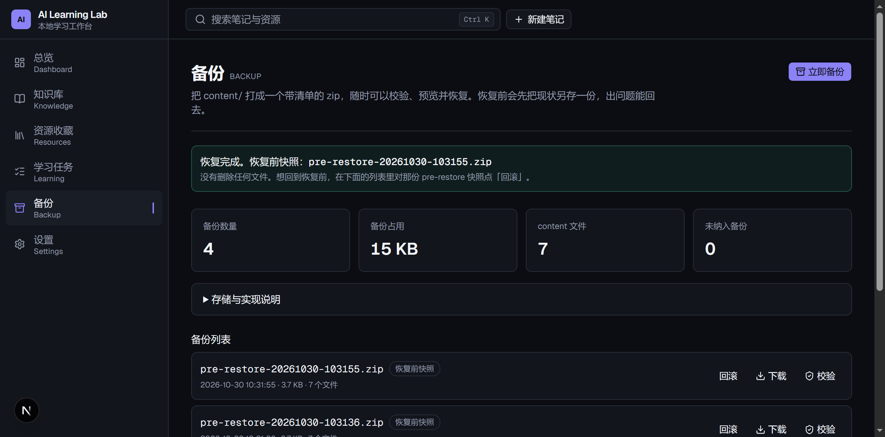

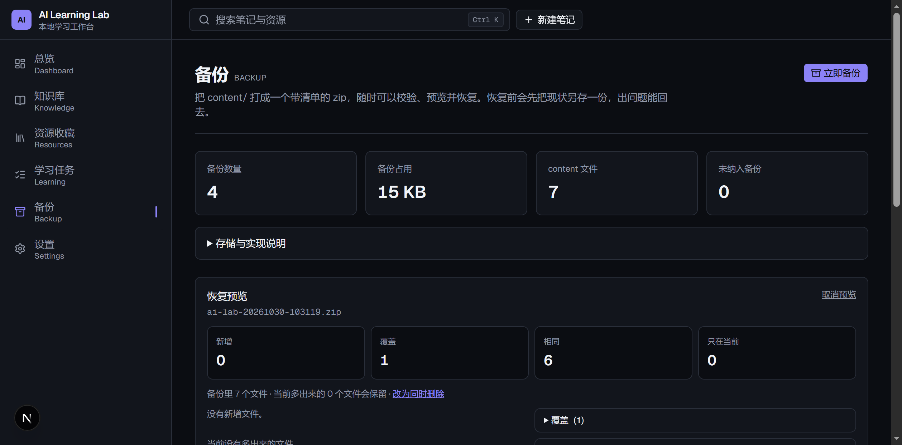

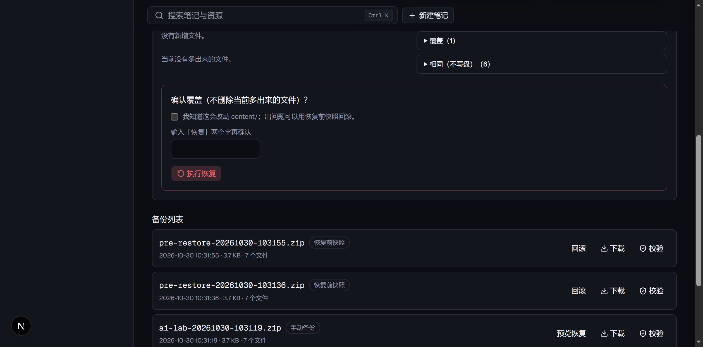

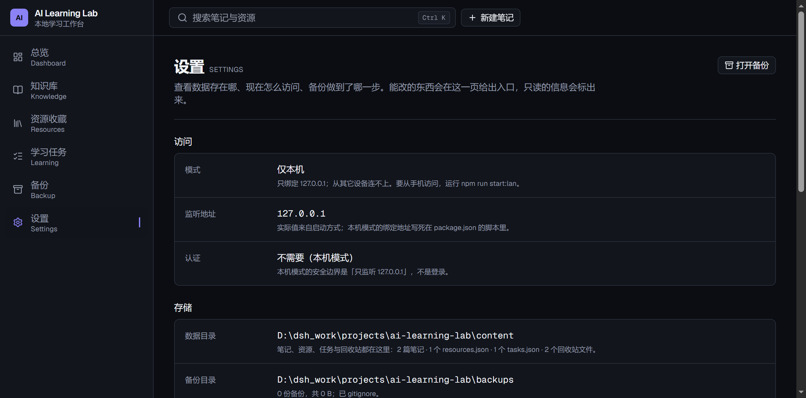

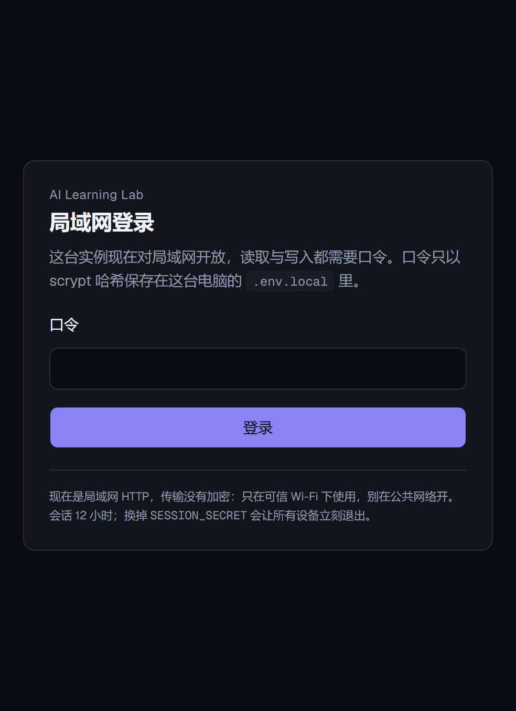


> 完整需求、验收标准与八阶段路线在 **[docs/需求书.md](docs/需求书.md)**（原始需求书，内容保持原样）。

## 写笔记（两种方式都行）

**方式一：界面** —— `/knowledge` → 新建笔记 → 写 → 保存。文件名由标题生成（中文照抄），创建后不再改名；重名自动加 `-2`。

**方式二：任何编辑器** —— 把 `.md` 文件放进 `content/articles/`，刷新 `/knowledge` 就能看到。**文件名就是文章 id**，frontmatter 里的 `id` 必须与它一致：

```markdown
---
id: transformer-basics
title: Transformer 基础
category: Deep Learning
tags:
  - Transformer
  - Attention
createdAt: "2026-10-20"
updatedAt: "2026-10-27"
---

正文从这里开始。支持 GFM 表格、```代码块```、$行内公式$、$$块级公式$$。
```

规则（都有测试守着）：
- `id`：字母/数字开头，可含 `-`、`_` 与中文，1–64 位，且必须是文件名去掉 `.md` 之后的部分；`con`/`nul`/`new` 这些保留名不能用（界面会自动加 `note-` 前缀）
- `updatedAt` 不能早于 `createdAt`；日期格式 `YYYY-MM-DD`（本地时区，不是 UTC）
- `tags` 可以省略（等于空数组），其余字段必填；自己加的额外 frontmatter 字段会被保留
- 以 `_` 开头或以 `.` 开头的文件/目录被跳过（模板、草稿、`.trash/`）
- frontmatter 写错的笔记只会单独报错（列表顶上会提示），不会让整页崩掉
- 删除 = 移到 `content/articles/.trash/`，不是真删；想找回来直接拖回来
- 内部链接就是普通 Markdown 链接：`[另一篇](/knowledge/transformer-basics)`（`[[双向链接]]` 属于 P1，本阶段不做）；外链自动加 `target="_blank" rel="noopener noreferrer"`

> `content/articles/` **不在这个仓库里**（主仓库是公开的，笔记属于你自己的私有仓库 —— 见 [docs/架构决策.md](docs/架构决策.md) D5）。

## 设计原则

- **Local-first**：内容与数据库都在自己电脑上，不依赖云
- **Knowledge-first**：先保证笔记、资源与搜索好用
- **Secure by default**：默认只监听 `127.0.0.1`，局域网访问须显式开启并保护
- **AI-ready, not AI-dependent**：为将来的 AI 功能留口子，MVP 不依赖任何模型服务

## 快速开始

```powershell
git clone https://github.com/danri-web/ai-learning-lab.git
cd ai-learning-lab
npm install
npm run dev
```

打开 <http://127.0.0.1:3000>。

### 手机 / 局域网（可选，默认关闭）

默认只监听 `127.0.0.1`，手机连不上（这是故意的）。要用手机访问：

```powershell
# 1) 设一次口令：只把 scrypt 哈希写进 .env.local（不进 Git、不进备份）
npm run auth:set-password

# 2) 局域网模式用生产构建，不用 dev
npm run build
npm run start:lan
```

`start:lan` 会绑定 `0.0.0.0`、强制 `ALLOW_LAN=1`，并在启动前检查口令哈希与会话密钥；缺一个就拒绝启动。手机和电脑连同一个 Wi-Fi，打开终端打印的 `http://<电脑局域网 IP>:3000`，输入口令登录。第一次连不上时检查 Windows 防火墙的**专用网络**是否放行该端口（**不要**为了省事关掉整个防火墙）：

```powershell
New-NetFirewallRule -DisplayName "AI Learning Lab" -Direction Inbound -Protocol TCP -LocalPort 3000 -Action Allow -Profile Private
```

局域网是 **HTTP，不加密**：只在可信 Wi-Fi 下用，不要做端口转发。会话 12 小时；换掉 `SESSION_SECRET` 会让所有设备立刻退出。

环境：Windows 10 + Node.js 24.21 + npm 11.19（实测版本）。环境变量示例见 `.env.example`，复制为 `.env.local` 后修改。

### 重新安装 / 换一台电脑 / 从备份恢复数据

`content/` **不在仓库里**（D5：主仓库是公开的，笔记属于你自己的私有仓库），所以新 clone 下来笔记列表是空的 —— 这是预期，不是 bug。要把数据搬过来：

1. 装 Node.js 24 / npm 11、Git；Windows 上再装 Chrome（E2E 用系统 Chrome，不下载 Chromium）
2. `git clone https://github.com/danri-web/ai-learning-lab.git` → `cd ai-learning-lab` → `npm ci`
3. 把之前备份的 `ai-lab-<时间戳>.zip` 放进 `backups/`（没有这个目录就新建；它已 gitignore）
4. `npm run build`，再 `npm run start`，打开 <http://127.0.0.1:3000>
5. 进 `/backup` → 对那份 zip 点 **预览恢复** → 看「新增 / 覆盖」→ 勾选确认框、输入「恢复」→ **执行恢复**。
   应用会先建 `pre-restore` 快照，再预检、原子写入、重扫校验；中途失败自动回滚
6. 打开 `/knowledge`、`/resources`、`/learning` 确认数据回来了

> 备份是**明文 zip**（含全部笔记），别放公开同步盘。新机器上建议先恢复再写新内容，避免「两边都有改动」。
> 这条流程在 2026-10-30 用 `_scratch/release-check` 的干净副本实测过（见下面「阶段 8」）。

## 已实现的脚本

```powershell
npm run dev          # 开发服务器（127.0.0.1:3000）
npm run build        # 生产构建
npm run start        # 运行生产构建（127.0.0.1:3000）
npm run start:lan    # 局域网模式（生产构建 + 强制口令；先 build）
npm run auth:set-password # 设置/重置局域网口令（写 scrypt 哈希到 .env.local）
npm run lint         # ESLint 9
npm run typecheck    # next typegen && tsc --noEmit
npm run test         # Vitest（单元 / 集成 / 源码闸门）
npm run test:watch   # Vitest 监听
npm run test:e2e     # Playwright 端到端（系统 Chrome；自动起隔离副本）
npm run test:e2e:headed # 同上，带界面（调 UI 时用）
npm run verify       # 四条一起：typecheck → lint → test → build
npm run format       # Prettier 写入
npm run format:check # Prettier 只检查
```

`npm run verify` 是交付前的一条命令闸门：四步任一失败就停下；它不跑 `publish-check`（那是工作区脚本，见交接 §5），也不跑端到端（E2E 要起服务，慢且会写测试数据，单独一条命令，见下面「测试与发布」）。

## 测试与发布（阶段 8）

交付门槛是两条命令：`npm run verify`（**451 条断言：450 通过 + 1 跳过**，跳过的是本机建不出的文件级符号链接）和 `npm run test:e2e`（Playwright）。端到端**不在 `verify` 里**：它要起服务、会改测试数据、单轮约 2.5 分钟，塞进每次提交会让人开始跳过闸门。

### 端到端测试怎么隔离数据

E2E 会新建/编辑/删除笔记、建备份、真的执行恢复 —— 这些只能发生在一次性副本里：

- `scripts/e2e-server.mjs` 先把**当前工作树**（含未提交改动）复制到系统临时目录，再复制 `node_modules`（Windows 用 `robocopy /MT`，36k 文件约 6 秒；Turbopack 不接受指向工作区外的目录联接，实测会报「Could not find the Next.js package」）
- 用 `e2e/fixtures/content/` 覆盖副本的 `content/`：2 篇夹具笔记（含中文 id）、2 条资源、2 条任务
- **安全闸门**：副本路径落在仓库里时脚本直接退出；`app/` 已存在但没有所有权标记（`.ai-learning-lab-e2e`）时也拒绝删除 —— 防止 `E2E_SCRATCH` 误配到另一个恰好有 `app/` 的项目根。`tests/e2e-safety.test.ts` 用真进程撞过这两条；端口固定 **3210（本机）/ 3211（局域网模式）**，不碰真实 dev 的 3000
- 3211 用 `ALLOW_LAN=1` + 测试口令 + 随机 `SESSION_SECRET` 起第二个实例，专门验认证
- 想改测试时用 `E2E_REUSE=1 npm run test:e2e`（复用上次副本与构建，省掉 70 秒构建）；`E2E_SCRATCH=<dir>` 可以指定副本位置

### 测什么

| 用例 | 平台 | 内容 |
| --- | --- | --- |
| `00-smoke` | Windows + Pixel 7 | 总览真实数字、五页导航、404 有出口、**无浏览器错误**、390–412px 不横向溢出 |
| `10-notes` | Windows | 新建（中文标题 → 中文文件名）→ 编辑 → `Ctrl+K` 搜到 → 删除进回收站 |
| `20-resources-tasks` | Windows | `javascript:` 链接被服务端拒绝；合法链接收藏/删除；任务新建、列表改状态、删除；**校验失败后 select/radio 不被清空**（回归） |
| `30-backup-restore` | Windows | 改笔记 → 备份 → 再改 → 预览 → 确认恢复 → 内容回退 → 对 `pre-restore` 快照回滚 |
| `40-auth` | Windows（3211） | 未登录页面 307、action POST 401、错误口令提示、登录后能读、登出后回到 307 |
| `50-a11y` | Windows | axe 扫 7 个页面 + 搜索弹窗 + 登录页（WCAG 2 A/AA） |
| `60-perf` | Windows | 五个页面的 Navigation Timing + 搜索弹窗里的真实毫秒数 |

> Pixel 7 只跑冒烟（导航、布局、控制台错误）：真机 Android 已在 2026-10-30 用 iQOO Z11 Turbo / originOS 6 完整验过（登录、五页、笔记闭环、搜索、资源/任务、备份、390px），E2E 不再假装覆盖真机。

### 可访问性

`@axe-core/playwright` 扫 WCAG 2 A/AA，**只把 critical / serious 当失败**（moderate / minor 会打印出来，但本地单用户应用里有一批评分标准意义不大，见 ADR D14）。2026-10-30 结果：**九个界面全部 0 命中**。修掉的两个真问题：搜索按钮的 `aria-label` 与可见文本不一致（2.5.3）、设置页把按钮直接塞进 `<dl>`（`definition-list`）。

### 性能基线（2026-10-30，Windows 10 / Node 24.21 / 系统 Chrome 156）

同一天跑了三次，数字会波动，所以给范围而不是单次快照：

| 页面 | DOMContentLoaded | load |
| --- | --- | --- |
| 总览 | 90–231 ms | 230–258 ms |
| 知识库 | 71–88 ms | 76–93 ms |
| 资源收藏 | 61–89 ms | 99–138 ms |
| 学习任务 | 93–170 ms | 131–180 ms |
| 备份 | 146–237 ms | 154–246 ms |

搜索（2 篇笔记 / 2 条资源，扫盘 + 解析 + 匹配）：**2.7–4.8 ms**（界面上显示的数字，和用户看到的一致）。阈值定得很宽（页面 3s、搜索 500ms），要抓的是"某次改动把页面拖成几秒"，不是微基准。

### 阶段 8 抓到的三个真问题

| # | 问题 | 怎么发现的 | 修法 | 回归 |
| --- | --- | --- | --- | --- |
| 1 | **校验失败后 `<select>` / 单选框看起来被清空**（React 19 在 form action 后 reset 表单；text input 会被写回，select/radio 的 value 没变就不重写 DOM） | E2E 填 `javascript:` 链接提交后，断言"类型仍是工具"直接红；单独探针确认 state 其实还在 | 失败后把 DOM 同步回组件 state（只操作 DOM，不 setState） | 资源：断言类型仍为 `tool`；任务：先空标题提交一次，断言「进行中」仍选中 |
| 2 | 搜索按钮 `aria-label` 与可见文本不一致（WCAG 2.5.3 serious） | axe | 去掉 `aria-label`，用 `sr-only md:not-sr-only` 文本，手机也有可访问名称 | `50-a11y` |
| 3 | 设置页 `<dl>` 里直接放了按钮 | axe `definition-list` | `Section` 加 `footer`，按钮移出 `<dl>` | `50-a11y` |

### 刻意不做的

- **不做截图对比**：界面还在演进，像素级红是噪音；布局回归靠"不横向溢出"这条真实断言
- **不跑 Lighthouse**：它测的是公网/首屏场景，本地单用户应用的数字没有决策价值；性能只看真实页面的 Navigation Timing
- **不测 Firefox / Safari**：需求书范围是 Windows + Android；多一套浏览器 = 多一份维护，等真有用户再说
- **不进 CI**：这是本地优先的单机项目，没有 CI 服务；`verify` + `test:e2e` 就是本机闸门

## 技术栈

| 领域 | 选型 |
| --- | --- |
| 框架 | Next.js 16.4.3（App Router、Turbopack） |
| UI | React 19.3、Tailwind CSS 4、shadcn/ui（`radix-nova`）、Lucide |
| 语言 | TypeScript 5（`strict: true`） |
| 测试 | Vitest 5（单元 / 集成 / 源码闸门）；Playwright 1.64（E2E，系统 Chrome）；@axe-core/playwright 4.14（可访问性） |
| 格式化 | Prettier 3 |
| 搜索 | 直接扫 `content/` + 纯函数子串匹配（**无索引**，见 [docs/架构决策.md](docs/架构决策.md) D6 / D10） |
| 备份 | `yazl` / `yauzl` 读写 zip；manifest + 每文件 sha256 自检（D12） |
| 认证 | scrypt 口令哈希 + HMAC 会话 cookie（Web Crypto），`proxy.ts` + 布局 + 每个 action 三道门（D12） |
| 计划中 | SQLite（只在搜索/列表真慢到 >300ms 时才考虑，且只当可重建的缓存） |

## 目录

```text
app/(workspace)/   页面：总览 / 知识库（列表、[id] 详情、new 新建、[id]/edit 编辑）
                  knowledge/actions.ts = Server Action（只做 FormData ↔ 对象 + 跳转）
features/articles/  service.ts = 业务规则（唯一决定"能不能写"的地方）
features/resources/ 资源收藏的 service 与表单状态
features/tasks/     学习任务的 service 与表单状态
components/layout/ 外壳：侧栏、顶栏、手机抽屉、页面标题
components/ui/     shadcn 组件 + 空状态
components/knowledge/  Markdown 渲染器 + 编辑器 + 删除确认
components/resources/  收藏表单 + 删除确认
components/tasks/      任务表单（多选关联）+ 状态切换 + 删除确认
lib/content/       笔记读写（articles/write）、资源读写（resources/resources-store）、
                   任务读写（tasks/tasks-store）、备份与恢复（backup-store/restore-store/
                   backup-format/backup-validate）、id 与校验、BOM 处理
lib/markdown/      目录提取、标题锚点分配、正文整形
lib/search/        搜索：纯函数（匹配/摘要/高亮区间）、取数（笔记+资源归一）、接口类型
lib/security/      文章 id 规则、路径闸门、资源 URL 白名单、会话（session）、口令（password）、
                   访问配置（auth-config）、登录限速、备份条目闸门（backup-entry）
lib/fs/            原子写入（临时文件 + fsync + rename）、进程内写锁
proxy.ts           每个请求的第一道门（局域网认证 / 本机绑定 fail closed）
scripts/           auth-lib / set-password / start-lan / env-file / e2e-server（隔离副本）
e2e/               Playwright 用例、共享断言、fixtures（假笔记/资源/任务，不进 content/）
playwright.config.ts  两个 project（Windows Chrome / Pixel 7）+ 自动起隔离服务
tests/             Vitest 单元测试（451 条，其中 1 条在本机会 skipped）
docs/              需求书、架构决策、截图
backups/           备份 zip（gitignored；明文，别放公开同步盘）
public/            静态资源
```

`content/`（笔记、resources.json、tasks.json、.trash）由你自己维护，仓库里不建空壳；`backups/` 在第一次备份时创建，已 gitignore。

## 阶段进度

| 阶段 | 内容 | 状态 |
| --- | --- | --- |
| 1 | 工程初始化 | ✅ 2026-10-29 |
| 2 | 设计系统与页面框架 | ✅ 2026-10-29 |
| 3a | Markdown 知识库：只读（列表 / 详情 / 渲染） | ✅ 2026-10-29 |
| 3b | Markdown 知识库：写入（编辑器 / 保存 / 删除） | ✅ 2026-10-30 |
| 4 | 资源收藏中心 | ✅ 2026-10-30 |
| 5 | 全文搜索 | ✅ 2026-10-30 |
| 6 | 学习任务与 Dashboard | ✅ 2026-10-30 |
| 7 | 备份、安全与局域网访问 | ✅ 2026-10-30 |
| 8 | 测试与本地发布 | ✅ 2026-10-30 |

### 阶段 2 具体做了什么

- **设计令牌**：需求书 §6 的十个色值全部落到 `app/globals.css` 的 CSS 变量，组件里零硬编码颜色（有测试守着）
- **外壳**：桌面 = 侧栏 + 顶栏 + 主区；手机 = 顶栏 + 抽屉导航 + 单列（Esc 关闭、焦点由 Radix Dialog 管住）
- **五个页面骨架**：都有空状态，并写明「哪个阶段接入真实数据」，不放假数据
- **只绑定本机**：`next dev/start` 显式 `-H 127.0.0.1`（Next 默认绑 `0.0.0.0`，实测过）
- **断言**：令牌 ↔ 需求书、导航 ↔ 页面文件、脚本 ↔ 安全要求，共 19 条
- **自查修掉的 6 处问题**（生产构建 + DevTools 协议实测，不是看代码猜的）：五个页面标题重复、404 页沿用 Next 默认样式且没有导航、404 页 React 水合错误 `#418`、次要文字对比度只有 4.58:1、跳过导航链接不移动焦点、长字符串（如长 URL）横向溢出 542px

### 阶段 3 的闸门（功能还没写，先把门锁上）

阶段 3 才开始读写文件，但三条防线已经先落地，并且每条都用恶意样本撞过：

| 防线 | 实现 | 断言 |
| --- | --- | --- |
| 路径穿越 | [lib/security/paths.ts](lib/security/paths.ts)：`resolveArticlePath` 做字符串校验（id 白名单）；`resolveArticleFile` 再加物理校验（正文目录不能是链接、目标文件不能是链接、真实路径仍在目录内） | 32 个恶意 id 全部拒绝；真实 junction 夹具证明"只做字符串校验会被骗过"，而 `resolveArticleFile` 会拒绝 |
| 半截文件 | [lib/fs/atomic-write.ts](lib/fs/atomic-write.ts)：临时文件 + fsync + rename（Windows 上带退避重试），失败时连同关闭句柄一起清理 | 并发 8 个写入者不互相踩、失败时原文件不变、不留 `.tmp`；**故障注入**让 `close()` 失败，验证仍会清理 |
| XSS 面 | [tests/security-gates.test.ts](tests/security-gates.test.ts)：源码级禁令 | 禁止 `dangerouslySetInnerHTML`、`eval`/`new Function`、`rehype-raw`、以及**在 `lib/fs` 与 `lib/security/paths` 之外 import 任何 fs 模块**（扫 import，别名绕不过）；扫描器有假样本自检，并明确记录它抓不到的形态 |

> 2026-10-29 外部审计（4 条 P2/P3）已全部处理：`close()` 失败漏临时文件（故障注入证实并修复）、
> 路径校验是词法而非物理（junction 实证 + 新增 `resolveArticleFile`）、扫描器漏别名导入（改为扫 import）、
> 一条测试的描述与断言矛盾（删掉 `ext` 参数，从根上消除）。断言从 37 条增至 45 条。
>
> 同日第二轮外部审计（3 条 P2）也已处理：Windows 路径大小写会让合法目录被误拒（`fs.realpath` 返回规范大小写，
> 改成平台感知的比较）、`.gitignore` 漏了 `/content/articles/`（ADR 说已保护但没有落地 —— 文档撒谎比没写更危险）、
> 链接夹具建不出来时测试会**静默通过**（改为 `it.skipIf`：跳过就是跳过，有 1 条在受本机限制时会显示 skipped）。

## 安全

- **默认只监听 `127.0.0.1`**：`dev` / `start` 脚本里写死 `-H 127.0.0.1`，有断言守着；从局域网 IP 连是 connection refused
- **局域网必须显式打开**：只走 `npm run start:lan`（生产构建 + `ALLOW_LAN=1` + 绑定 `0.0.0.0`）；口令哈希或会话密钥缺一个就拒绝启动，不会退回「不登录也能看」
- **认证覆盖读取与写入**：`proxy.ts`（第一道）→ 工作区布局（第二道）→ 每个 Server Action / 受保护 Route Handler 里的 `requireAuth()`（第三道）；`/login`、`/api/auth/login`、`/api/auth/logout` 之外全部要会话
- **会话**：HttpOnly + SameSite=Lax + 12 小时；HMAC 签名，改 payload/签名/换密钥都会失效；登出清 cookie
- **口令**：只存 scrypt 哈希在 `.env.local`（`scrypt:N:r:p:salt:hash`，用 `:` 避免 Next 的 `$` 变量展开）；登录连续失败 5 次锁 5 分钟（全局桶，不按 IP；换 `X-Forwarded-For` 不能绕过）
- **备份**：`backups/` 已 gitignore；zip 是**明文**，不要放公开同步盘，也不要分享；备份**不含** `.env.local`
- **不提供服务端抓取任意 URL 的能力**（避免 SSRF），外部链接只允许 http / https
- **安全响应头**：X-Frame-Options、X-Content-Type-Options、Referrer-Policy、Permissions-Policy、COOP/CORP；CSP 暂未启用（原因见 ADR D12）
- **局域网是 HTTP，不加密**：只在可信 Wi-Fi 下用；不要做端口转发。详细条目见 [docs/需求书.md](docs/需求书.md) §8 与 [docs/架构决策.md](docs/架构决策.md) D12

## License

[MIT](LICENSE) © 2026 Daniel Riviera

### 阶段 3a 具体做了什么

- **读文件，不建库**：`content/articles/*.md` 每次请求都扫一遍（D1），没有数据库、没有索引、没有缓存
- **frontmatter 用 Zod 校验**：写错的笔记单独报错并在列表顶部提示，不让整页崩；`id` 必须与文件名一致
- **渲染**：react-markdown + remark-gfm（表格/任务列表）+ remark-math & rehype-katex（公式）+ rehype-highlight（代码高亮）+ 自动目录
- **不执行正文里的 HTML**（不装 rehype-raw，源码闸门守着）
- **手机上不横向溢出**：宽表格套横向滚动容器；实测 390px 溢出 0
- **两个页面都是动态渲染**（`force-dynamic`），刷新即读到文件最新内容
- 断言：81 条（frontmatter 好坏样本 21 条、目录提取 8 条、路径/原子写/源码闸门等）

### 阶段 3b 具体做了什么（写入）

- **写入链路只有一条**：`Server Action → features/articles/service.ts → lib/content/write.ts`。源码闸门断言"只有 service 能被 import 到这个写入模块"，页面想绕过就红
- **写之前先证明读得回来**：生成的 frontmatter 先过一遍自己的解析器（`parseArticle`），过不了就不落盘 —— 宁可保存失败，也不留一个应用自己打不开的文件
- **保存保留用户数据**：`createdAt` 不变、文件名不变（改标题不改名）、用户自己加的 frontmatter 字段原样保留
- **删除进回收站**：移到 `content/articles/.trash/20261030-153012-<id>.md`，内容一字不差；`.trash` 是以 `.` 开头的目录，列表天然跳过
- **编辑器**：左写右看（窄屏切"写/看"）、实时预览（`useDeferredValue`，打字不卡）、未保存提醒（`beforeunload`）、保存失败时字段不丢且错误回到字段旁边
- **中文文件名**（ADR D7）：`Transformer 的注意力机制（上）` → `Transformer-的注意力机制-上.md`；重名 `-2`；全符号标题退回 `note-YYYYMMDD-xxxx`
- **实测踩到的坑**：Next 16 把动态段原样（未 URL 解码）交给页面，中文 id 会全被判非法 → 统一走 `articleIdFromParam()`
- 断言：116 条（新增 id/文件名生成 18 条、写入 16 条；1 条文件级符号链接的断言在本机 skipped）

### 外部审计 v3：4 条发现全部为真，已修（2026-10-30）

审计是外部模型做**静态审查**（不跑代码），4 条都附了 `文件:行号`。我逐条写了复现，**先看着它失败，再修**：

| # | 发现 | 复现结果 | 修法 | 回归断言 |
| --- | --- | --- | --- | --- |
| F1 | 并发新建会互相覆盖 | 同一标题 **8 路并发创建 → 只活下来 1 个 id**（8 个请求都报成功） | 写操作进程内串行（[write.ts](lib/content/write.ts) 的 `serialize`） | 8 路并发必须得到 8 个不同 id、8 份内容都在 |
| F2 | 过期保存静默覆盖新内容 | 两个编辑器先后保存 → 旧稿覆盖新稿，两次都返回成功 | 编辑器带正文指纹（sha256）提交，写入前比对；不一致就拒绝并给「仍然覆盖」（ADR **D8**） | 旧指纹保存被拒且磁盘不变；`force` 可覆盖 |
| F3 | 正文 `trim()` 破坏 Markdown 语义 | 以 4 空格开头的缩进代码块被压平（读一次就丢） | 只归一两端空行（[body-text.ts](lib/content/body-text.ts)），并加**正文等式检查** | 缩进 / 行尾空格 / 代码块原样往返 |
| F4 | 同名标题的目录锚点没有落点 | 目录给 `example-1`，渲染器两个都是 `example`（重复 id） | 目录与渲染共用一套分配逻辑（[heading-ids.ts](lib/markdown/heading-ids.ts)） | 每个目录锚点都恰好对应一个标题 id |

> 断言从 116 条增至 **130 条**；F1/F2/F3 的复现都先跑出失败输出，再改代码。

### 阶段 4 具体做了什么（资源收藏）

- **一个 JSON 就是全部资源**：`content/resources.json`（`{ version: 1, resources: [...] }`），和笔记一样文件是真相；主仓库 gitignore，跟笔记一起进那个私有仓库
- **URL 只认 http / https**（[resource-url.ts](lib/security/resource-url.ts)）：`javascript:`、`data:`、`file:`、相对路径、裸域名、带凭据的地址全拒；**服务端从不 fetch 用户给的地址**，所以没有 SSRF 面
- **写入沿用笔记的地基**：进程内写锁 + 原子写 + 写前自检；单条资源的指纹做「过期保存」检查（D8 同款），冲突时给「仍然覆盖」
- **文件坏了不覆盖**：`resources.json` 解析失败时，页面报出具体原因，应用**拒绝任何写入**（宁可停手，也不要把用户的坏文件连同修复机会一起覆盖掉）
- **删除可恢复**：从数组移除的同时，把这条记录追加到 `content/.trash/resources-deleted.jsonl`（带删除时间），贴回 JSON 就回来
- **筛选 / 排序**：类型 / 分类 / 标签三组 chips（带计数）+ 三种排序（最近更新 / 最近添加 / 按标题），全部用 URL 参数，刷新与分享都能保留
- **关联笔记**：表单里从现有笔记里选，列表上显示成可点的链接（逻辑关联，不校验对方是否还存在）
- 断言：149 条（新增 URL 白名单 4 条、资源读写 15 条；1 条文件级符号链接的断言在本机 skipped）
- **实测踩到的坑**：客户端表单从带 `node:fs` 的模块里 import 常量 → Turbopack 报 "does not support external modules (request: node:fs)"，构建直接失败；把纯常量拆到 `lib/content/resource-types.ts` 后正常

### 阶段 5 具体做了什么（全文搜索）

- **不建索引**（D6 的落地形态，记为 **D10**）：每次搜索都直接扫 `content/articles/*.md` + `content/resources.json`。实测 2 篇笔记 / 1 条资源 **6–16ms**（界面上就写着「已扫描 N 篇笔记 / M 条资源 · X ms」）。文件是真相，所以**不存在"索引过期"**：新建、改标题、删掉，下一次搜索立刻就是对的
- **三层分开**：`lib/search/query.ts`（纯函数：匹配 / 摘要 / 高亮区间，完全不碰文件系统，可以脱离磁盘测）→ `lib/search/sources.ts`（把笔记与资源归一成同一形状，笔记走 `resolveArticleFile`，所以 junction/symlink、`_`/`.` 开头、`.trash/` 一律进不来）→ 只读 Server Action（`app/(workspace)/search-actions.ts`）
- **中文友好**：子串匹配，`模型`、`机制` 这类 2 字词直接命中；FTS5 的 `unicode61` 对中文 0 命中、`trigram` 搜不到 2 字词，这也是不上它的原因
- **大小写不敏感用正则的 `i` 标志**，而不是把两边都 `toLowerCase()` —— 大小写折叠会改变字符串长度（`İ` → 两个码元），长度一变高亮下标全错
- **摘要只回片段**：命中点前 40 / 后 80 个码元，尽量切在空白处，且**不劈开 UTF-16 代理对**（emoji 落在窗口边界时整个保留）。断言直接钉了「摘要长度 < 140」——搜索不该把整个库吐给浏览器
- **高亮不拼 HTML**：后端只返回区间 `{start, end}`，前端切片 + `<mark>`；用户正文里的 `<script>` 永远只是文字（源码闸门禁往 DOM 塞 HTML）
- **多词是 AND**：「注意力 RNN」只要两者都有的那篇；词序不影响结果；`.*`、`(a+b)` 这类按字面匹配，不会变成正则
- **弹窗**：`Ctrl+K` / `⌘K` 开关，结果按**笔记 / 资源分组**；`↑↓` 选择、`Enter` 打开、`Esc` 关闭、焦点由 Radix 圈在弹窗里；**中文输入法组字期间的回车不算"打开"**（`isComposing` / `keyCode 229`）；加载 / 空 / 错误 / 查询过长 / 结果截断 五种状态都有话说
- **「索引重建」的落点**：没有索引可重建，所以做成弹窗底部的「重新扫描」——点一下重扫并刷新「已扫描 N/M · X ms」，这同时就是需求书验收项「增删改后索引更新」的证明
- **搜索是只读的，有断言**：跑两次搜索前后，夹具目录里每个文件的大小与 mtime 必须一模一样
- 断言：186 条（新增 37：纯函数 24、取数 13；1 条文件级符号链接的断言在本机 skipped）
- **实测踩到的坑**：① 新文件的注释里顺手写了源码闸门禁掉的那个标识符，闸门当场把这个文件抓红 —— 闸门对注释一视同仁，是对的；② 摘要把 Markdown 表格的分隔行（`| --- | --- |`）原样带出来了，补了「分隔行整行去掉、竖线当空格」；③ 第一次输入到结果返回之间（防抖 140ms + 一次往返）界面会闪一下「没有找到」——那不是"没找到"，是"还没回来"，改成「搜索中…」

### 阶段 6 具体做了什么（学习任务与总览）

- **一个 JSON 就是全部任务**：`content/tasks.json`（`{ version: 1, tasks: [...] }`），和资源同一个形态（D9 的地基，记为 **D11**）。主仓库 gitignore，跟笔记一起进那个私有仓库
- **只有三档状态**：待办 / 进行中 / 已完成。需求书 §7 明确说"不要甘特图、复杂项目管理、AI 排课"，所以一个字段就够
- **截止日期可选，逾期会自己算**：`dueInfo()` 把日期翻成人话（`逾期 2 天` / `今天到期` / `还剩 3 天` / `截止 2026-12-01`），**已完成的任务不喊逾期**（做完的事，日期过了不是问题）；日期用 UTC 算差，夏令时不影响
- **关联是多选**：一篇任务可以挂多篇笔记 + 多条资源（"学 Transformer Attention" 就是论文 + 教程 + 自己那篇笔记）。关联是**逻辑关联**：只存 id，断链在列表上显示成「笔记已失效：xxx」而不是崩掉
- **列表上直接改状态**：原生 `<select>`（键盘/读屏/手机都免费做对），走的是专门的 `updateTaskStatus` —— **只动 status 与 updatedAt**，不会把别处的草稿覆盖掉
- **写入沿用前三个阶段的地基**：进程内串行 + 原子写 + 写前自检 + 单条指纹（D8）；删除进 `content/.trash/tasks-deleted.jsonl`，贴回去就能恢复
- **总览页接真数据**：笔记 / 资源 / 任务 / 可搜索条目四个数字 + 最近笔记 + 进行中的任务 + 最近资源。**每个数字都是现读文件算的**，没有缓存也没有假值；某个数据文件坏掉时，顶部明确说"只统计了能读的部分"
- **统计口径只写一处**：`summarizeTasks()` 同时喂给总览和任务页的 chips，不各算各的
- 断言：234 条（新增 48：任务模型 31、任务写入 16、资源 BOM 1）
- **实测踩到的坑**：① **UTF-8 BOM** —— 用 PowerShell/记事本手改 `tasks.json` 会带上 BOM，`JSON.parse` 不认，界面报"不是合法 JSON"并拒绝写入（保护是对的，但文件其实没坏）。修法是在解析入口统一 `stripBom`，而不是要求用户"别用 BOM"；给任务和资源各补了一条断言，并先看着它失败；② 日期输入框不能"填"，只能逐个字段敲 —— 第一次敲成了 `0026-10-28`，表单当场把非法日期拦下来了（顺带证明校验生效）

### 阶段 7 具体做了什么（备份、安全与局域网）

**备份（D12）**

- **一个 zip + 一份清单**：`content/` 下白名单文件（Markdown、`resources.json`、`tasks.json`、`.trash/` 留档）打成 `backups/ai-lab-<时间戳>.zip`，根目录带 `manifest.json`（版本、时间、每个文件的 sha256）
- **建完立刻自检**：重读 zip，核对条目白名单、大小、sha256、压缩比、重复条目；任何一项不对就删掉这份新备份并报错。中文文件名按 UTF-8 原样往返（有测试）
- **不备份什么**：`.env.local`（口令哈希/会话密钥不跟着 zip 走）、`backups/` 自己、`content/.trash/restore-*`（恢复时的二级副本，快照兜底）；不在白名单的文件会列出来，不静默丢

**恢复（D12）**

- **只从 `backups/` 列表选**，不接受上传；先预览「新增 / 覆盖 / 相同 / 只在当前」，预览带 `planHash`
- **确认时重算 diff**：`planHash` 对不上（预览之后 content/ 又变了）直接拒绝，一个文件都不动
- **先把现状存成 `pre-restore-*.zip` 并回读校验**，再做预检（父目录不能是 junction/symlink、目标不能是链接/目录），然后原子写入；**默认不删除**当前多出来的文件，勾选后移进 `content/.trash/restore-*`（不是真删）
- **写完重扫比对 sha256**；中途失败自动用快照回滚。测试用**故障注入**让第二个文件写失败，断言 content/ 回到恢复前的字节状态
- **坏备份不毁数据**：截断 zip、非 zip、路径穿越条目、压缩炸弹、大小/哈希不一致、清单外/缺失条目、坏 `resources.json` 都在写任何文件之前被拒；现有文件字节与 mtime 不变

**认证与局域网（D12）**

- 默认仍只听 `127.0.0.1`；`npm run start:lan` 用**生产构建** + 显式 `ALLOW_LAN=1`，启动前检查 `LAB_PASSWORD_HASH` / `SESSION_SECRET`，缺一个就退出
- 口令只存 scrypt 哈希（`scrypt:N:r:p:salt:hash`）；会话是 HMAC 签名的 HttpOnly cookie，12 小时；登出清 cookie；换 `SESSION_SECRET` = 全端退出；登录失败 5 次锁 5 分钟（全局桶，不信任客户端转发头）
- **三道门**：`proxy.ts` 每个请求先过（页面、RSC、action POST 都算）→ `(workspace)/layout.tsx` 的 `requirePageAuth()` → 每个 Server Action / 受保护 Route Handler 里的 `requireAuth()`。这样「页面拦了、action 没拦」不会发生
- **fail closed**：局域网模式配置不齐 → 503 说明页；本机模式发现非本机 Host（有人绕过脚本手动绑 `0.0.0.0`）→ 503，不假装安全
- **Windows / Android**：README 上面给了 `auth:set-password` → `build` → `start:lan` 的步骤和**只放行专用网络**的防火墙命令；手机连同一 Wi-Fi，用终端打印的局域网 IP 访问
- **真机 Android（2026-10-30）**：iQOO Z11 Turbo / originOS 6，P40 开热点；登录、五页、笔记新增/编辑/删除、搜索、资源/任务、备份建/校验/预览、登出/后退、390px 布局全部通过。第一次连不上是 Windows 防火墙里 `node.exe`（Node 安装目录里的那个）的 **Block** 规则（阻止优先于允许），删掉后即通；不是应用问题

**断言与实测**

- 断言 234 → **444 条**（443 通过 + 1 条文件级 symlink skipped）：备份条目 46、manifest/diff 23、备份读写 16、恢复 9、回滚故障注入 3、删除恢复 4、会话 16、口令 13、访问配置 42、登录限速 5、登录路由 1、proxy 12、覆盖关系 7、脚本兼容 5，以及启动/源码闸门的增量
- 真浏览器点过：建备份（6 个文件 / 3.4 KB，自检通过）→ 改一篇临时笔记 → 预览「覆盖 1」→ 确认恢复（自动生成 `pre-restore` 快照）→ 对快照点「回滚」→ 内容回到改前 → 删除临时笔记与测试备份
- 真机网络：默认 `127.0.0.1` 从局域网 IP `connection refused`；`start:lan` 未登录请求 → 307 到 `/login`、action POST → 401、body 里 0 处笔记标题；用 curl 在局域网 IP 登录后拿到 200 与笔记内容；登出后同一 cookie 再请求回到 307
- 构建 0 警告（Turbopack 对运行时路径的 tracing 警告用 `/*turbopackIgnore*/` 消掉）

**实测踩到的坑**

1. **`.env.local` 里的 `$` 会被 Next 展开**：scrypt 原格式 `scrypt$32768$…` 写进去，`$32768` 被当成变量展开成空，登录永远失败。改成 `scrypt:N:r:p:salt:hash`（冒号分隔），并在脚本与 lib 之间用一条测试钉住格式兼容
2. **`next start -H 0.0.0.0` 时 `request.url` 可能是 `http://0.0.0.0:3100`**：用 `request.url` 做 Origin 比较或跳转，会把合法登录拒掉/把浏览器送到 `0.0.0.0`。改成优先用 Host 头还原 origin；浏览器在代理/扩展环境下还可能发 `Origin: null`，按「缺失」处理
3. **同一路由段不能同时有 `page.tsx` 和 `route.ts`**：登录页放 `/login`，表单 POST 放 `/api/auth/login`
4. **Turbopack 会把运行时拼接的路径当成「追踪整个项目」**：`path.join` 上加 `/*turbopackIgnore*/`，否则 build 出 4 条警告

### 外部审计 v4（2026-10-30）：3 条发现全为真，已修

审计包 v4（`8ea9497`）的三条都先写复现、看着它失败，再改：

| # | 发现 | 复现方式 | 修法 | 回归断言 |
| --- | --- | --- | --- | --- |
| F1 | 恢复先写文章、再检查删除目的地；检查失败时外层把 `PreflightError` 当成「一个文件都没写」跳过回滚 | 固定时间戳 + 在 `content/.trash/restore-<stamp>` 放一个普通文件：文章已写入，错误却说「没有改动」 | 删除目的地也在写第一个字节前预检（`restore-store.ts`） | 「说没有改动就必须字节不变」 |
| F2 | 资源/任务先删活动 JSON、再追加 `.trash`；第二步失败时记录已经没了 | 把 `.trash` 做成普通文件：删除返回失败，但 `resources.json` / `tasks.json` 已空 | 先写 `.trash`，再写活动 JSON；活动写失败时撤回刚追加的行 | 4 条：两个 store ×（trash 写失败 / 活动写失败） |
| F3 | 登录限速按 `X-Forwarded-For` 分桶，换头可绕过 5 次锁 | 源码：`clientKey` 读客户端可改的转发头 | 全局桶，不读转发头；代价是攻击者可故意失败锁住房主 5 分钟（D13） | 路由级：5 次不同 XFF 第 6 次被锁，且不再验口令 |

> 断言 437 → **444**；`npm run verify` 全绿。F3 的回归当时只有单元级（POST 5 次不同 XFF，第 6 次被锁且不再验口令）；
> 阶段 8 补上了真打局域网实例的 E2E（未登录 307 / action POST 401 / 登录 / 登出，见下面 `40-auth`）。

### 阶段 8 具体做了什么（测试与本地发布）

- **端到端（Playwright 1.64 + 系统 Chrome，不下载 Chromium）**：两个 project —— Windows 桌面 1440×900、Pixel 7（412×915 触摸）；7 个 spec，设计上 13 条实跑 + 7 条跳过（写入/认证/a11y/性能只在桌面跑，Pixel 7 只做冒烟）
- **数据隔离**：`scripts/e2e-server.mjs` 把工作树复制到临时目录、用固定夹具覆盖 `content/`、复制 node_modules、起 3210（本机）与 3211（`ALLOW_LAN=1`）两个生产实例。真实 `content/` 一行没动；副本落在仓库里时脚本直接拒绝（`tests/e2e-safety.test.ts` 用真进程撞过）
- **真实恢复闭环**：改夹具 → 备份（自检）→ 再改 → 预览 → 确认 → 内容回退 → 对自动生成的 `pre-restore` 快照点「回滚」→ 回到恢复前。没有拿任何真实笔记当实验品
- **局域网认证的真实请求**：未登录页面 307、action POST 401、body 不含笔记标题；错误口令有提示；正确口令登录后能读到夹具；登出后同一浏览器再访问回到 307。审计 v4 留的「F3 真机请求」在这里补上
- **可访问性**：axe 扫 7 个页面 + 搜索弹窗 + 登录页（WCAG 2 A/AA），**九个界面 0 命中**；修掉搜索按钮的 2.5.3 与设置页的 `definition-list`
- **性能**：五个页面 DOMContentLoaded 61–237 ms（同日三次运行），搜索 2.7–4.8 ms（2 篇笔记 / 2 条资源）
- **错误边界**：新增 `app/error.tsx`（`"use client"`、重试 + 回总览、不 import 服务端组件/fs）。为了证明它真接得住，在 `_scratch` 副本的 `/learning` 里故意 `throw`、重新构建后截图 —— **真实仓库里没有这行抛错代码**；桌面与 390px 两张截图在 `docs/`
- **重装/恢复演练**：在 `_scratch/release-check` 的干净副本里按 README 走
  `git clone（HEAD）→ npm ci（771 包，约 1 分钟）→ 放手机测试备份 zip → build → start →`
  `/backup 预览（新增 7 / 覆盖 0）→ 执行恢复 → 2 篇笔记 + 资源 + 任务都回来`；
  干净副本里再跑一遍 Vitest 也全过
- **断言**：444 → **451**（450 通过 + 1 skipped）。新增 `tests/error-boundary.test.ts` 3 条、`tests/e2e-safety.test.ts` 4 条；E2E 单独一条命令，不进 `verify`
- **实测踩到的坑**：① Turbopack 以最近的 lockfile 当工作区根，**不接受指向工作区外的 node_modules 目录联接**（`Could not find the Next.js package`）→ 改成 robocopy 真实复制；② React 19 在 form action 后 reset 表单，`<select>`/radio 的 value 没变时不会写回 DOM → 校验失败后控件看起来被清空（已修 + E2E 回归）；③ Next 的路由播报器也是 `role="alert"`，E2E 取 alert 必须收窄；④ 404 页的主文档本身会记一条 console error，不能和"脚本报错"混在一起断言；⑤ Pixel 7 设备档 + 系统 Chrome 要用 `channel: "chrome"`，否则会去找没下载的 Chromium

## 已知问题（2026-10-30）

"已知"= 知道、记录、暂不修；完整清单在 [docs/架构决策.md](docs/架构决策.md) 的「残余风险登记」，这里是发布相关的高频项：

| 问题 | 现状 / 影响 |
| --- | --- |
| 错误边界只覆盖根布局以下 | 根布局自己抛错没有被 `app/error.tsx` 接住（要 `global-error.tsx`）；正常使用碰不到，但不要假装全覆盖 |
| 可访问性只有自动扫描 | axe 覆盖不了读屏体验与真实键盘流程（搜索弹窗的键盘逻辑有单元/手测，但没有屏幕阅读器测试）；中文输入法组字期间的回车仍待人工确认 |
| 文件级符号链接的写入防护 | 本机建不出文件级 symlink，对应用例显示 **skipped**（1 条）；在能建的机器上会自动执行。看报告要数 skipped，不能只看绿色 |
| 局域网是 HTTP、不加密 | 只在可信 Wi-Fi 用，不做端口转发；CSP 也还没启用（Next 内联启动脚本需要 nonce，见 D12） |
| 备份是明文 zip、不自动清理 | `backups/` 会一直长；别放公开同步盘，需要时手动删旧备份 |
| 恢复只从 `backups/` 列表选 | 从 U 盘/另一台机器恢复要先手动把 zip 放进 `backups/`（有意为之：不接受上传，攻击面最小） |
| 跨进程并发写 | 进程内已串行（D8）；两个 `next dev` / 另跑 CLI 写同一目录仍是残余窗口 |
| E2E 的边界 | 写入流程只在 Windows project 跑，Pixel 7 只做冒烟；不做截图对比、Lighthouse、Firefox/Safari；不进 CI（本地单机项目） |
| 单条删除没有可视化回收站 | 笔记进 `content/articles/.trash/`、资源/任务进 `content/.trash/*.jsonl`；整库可用 `pre-restore` 快照回滚，单条要手工贴回（D12 定案） |
| `npm audit` 有 9 个告警、暂无修复 | 7 low 来自 `katex`/`rehype-katex`（渲染本地 Markdown 的公式），2 moderate 来自 `@tailwindcss/typography` 里的 `postcss-selector-parser`；都标了 no fix available。应用不渲染用户 HTML、也不接受外部上传，风险面限于自己写的笔记；升级依赖时重新评估 |
| 任务没有完成时间 / 不提醒 | 总览只统计完成几条，没有"本周完成"；逾期只在页面标红，不弹窗不发邮件 |
| `.trash/` 会进那个私有 git 仓库 | 删除 = 多一个被跟踪文件，历史只增不减；与备份的"恢复"是两套语义 |
